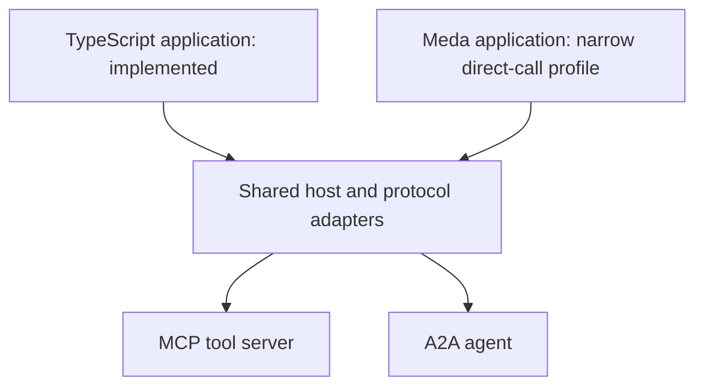

# Meda

**Meda is an experimental programming language for software that AI agents write
and maintain.**

The goal is to let a coding agent make a correct change with limited surrounding
context. The design combines explicit operation types and effects with
behavioral contracts. Editing tools restrict which code an
agent may change and check that it preserves protected contracts and interfaces.
The intended language supports ordinary application code as well as programs
that call LLMs, tools, and other agents.

**Today, this is a research prototype.** Both Meda and TypeScript now run the
same small MCP and agent-to-agent workflow through a shared host. Meda supports
a pure subset plus a narrow direct-call profile; there is no stable release.

## Why build a language?

That is the question we are testing. We compare Meda with a conventional strict
TypeScript client using the same runtime and protocol adapters. Protections
supplied by that shared runtime are useful to either language.

The [direct-call comparison](docs/decision-screen-results.md) produced matching
outcomes in all 11 paired scenarios. Both languages also passed the same small
maintenance change. Meda adds declared-effect checking, but this screen does
not establish enough benefit to justify expanding the language. **Our current
recommendation is library-first:** prioritize the shared runtime and TypeScript
client, and retain Meda as a research prototype.

## What exists today

| Part | Implemented | Still proposed or unproven |
| --- | --- | --- |
| Meda language | A parser, checker and evaluator; pure contracts; a narrow profile with five direct host calls, declared effects and opaque task references. | The full language design, general modules and broader effect support. |
| Editing tools | Guarded single-file edits for the pure profile, with protected contracts and validation before publication. | Effectful guarded edits and better AI maintenance outcomes than conventional tools. |
| Protocol runtime | A shared Python host, Meda and strict TypeScript applications, and official MCP/A2A SDK test peers. | Full acceptance and production readiness. |

The [pure profile](experiments/gates/PROFILE.md) and
[direct-call example](experiments/decision_screen/README.md) define what runs. [Design Draft 2.1](docs/design-draft-2.1.md) describes the larger
proposal; its examples are not all executable yet.

## Try actual Meda code

This [complete example](examples/clamp.meda) runs with the current interpreter:

```meda
operation clamp(value: Int, lower: Int, upper: Int) -> Int effects []
  require lower <= upper
  ensure result >= lower and result <= upper
{
  if value < lower {
    return lower
  }
  if value > upper {
    return upper
  }
  return value
}
```

`operation` declares a typed function. `effects []` means it is pure; this
standalone pure interpreter only supports pure operations. `require` checks a condition before
the body runs, and `ensure` checks the result afterward. These contracts run on
each invocation; they are not a proof that the implementation is correct.

From the repository root, using Python 3.11 or later, with no packages or API
keys to install:

```sh
python3 experiments/gates/meda.py check examples/clamp.meda
python3 experiments/gates/meda.py run examples/clamp.meda \
  --operation clamp --arguments '{"value": 12, "lower": 0, "upper": 10}'
```

The second command returns `{"profile": "meda-pure-b0/1", "value": 10}`.
For the language and editing checks:

```sh
python3 -m unittest discover -s experiments/gates/tests -v
```

## How MCP, other agents, and Meda fit together

Applications use typed operations exposed by a shared host. The host owns
credentials, permissions, budgets, and protocol adapters. MCP (Model Context
Protocol) connects to tools and data; A2A (Agent2Agent) connects to remote tasks.



Follow the [wiring walkthrough](docs/wiring-walkthrough.md) or start with the
actual [Meda workflow](experiments/decision_screen/workflow.meda) and
[TypeScript workflow](experiments/interop_d0/client/workflow.ts). The
example reads evidence, submits a report task, polls it, and validates the
result. Its peers use real protocol SDKs with deterministic test behavior;
there are no LLM provider calls.

The earlier [Meda workflow sample](experiments/interop_compare/clients/policy.meda)
only computes the next action for a Python controller to execute. It does not
make direct protocol calls. New protocols will require their own adapters and
compatibility checks.

## What happens next

The [bounded experiment](docs/decision-screen-results.md) is complete, including
the cancellation fix, explicit shutdown contract, direct Meda integration, and
one maintenance demonstration. The recommended next investment is making the
shared runtime easier to consume from conventional code and addressing its
[remaining acceptance gaps](https://github.com/meda-lang/meda/issues/11).
Further language expansion is paused pending evidence for a specific benefit.

For more detail, see the [roadmap](ROADMAP.md),
[research handoff and evidence index](docs/research-handoff.md), and
[tracked work](docs/issues/README.md).

## Project history

The [original prototype notes](docs/history/original-prototype.md) preserve the
earlier syntax ideas and the story of Meda's name and Sammy the seal.
`sample/`, `interpreter/`, and `interpreter_new/` are legacy work; use the
example and research implementation linked above for the current project.
