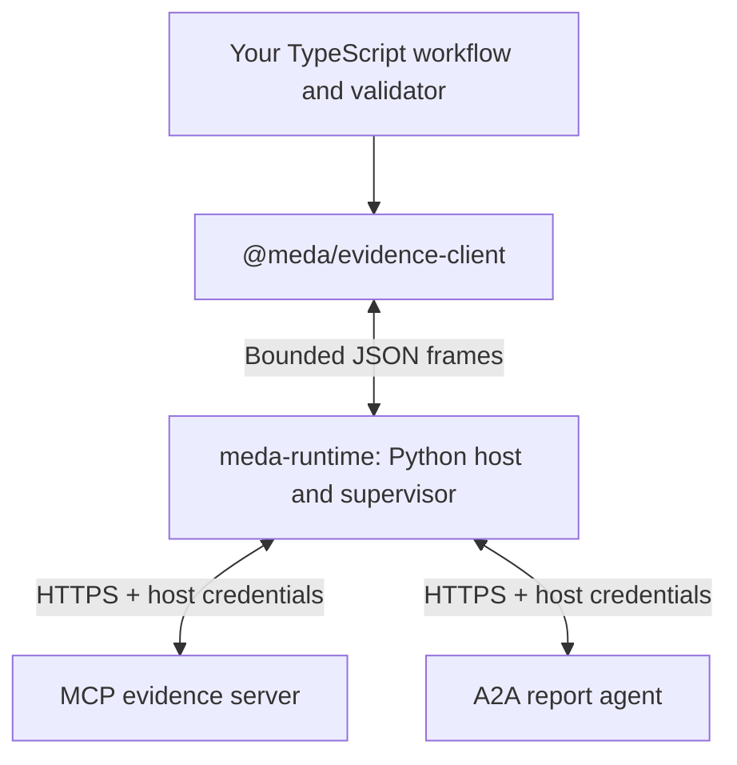

# Meda

**Meda's current focus is an experimental runtime for TypeScript applications
that call MCP tools and A2A agents.** It owns credentials, checks permissions
and budgets, and supervises the application process through completion and
cleanup.

Meda began as a programming-language experiment. We built that prototype and
[compared it with TypeScript using the same host](docs/decision-screen-results.md).
Both passed the same small workflow and maintenance screen. Most demonstrated
protections came from their shared runtime. We are pursuing that runtime first;
further language expansion is paused.

There is no stable release. The first packages support one small **evidence-to-report
workflow**, with five typed operations and evidence revision 1. They are not a
general MCP or A2A SDK, and the broader acceptance work remains open.

## Start with the runnable application

The [TypeScript example](examples/evidence-report/README.md) reads facts from an
MCP server, asks an A2A agent to select them, handles task states, and checks the
returned report. Its entry point is:

```typescript
import {runWorker} from "@meda/evidence-client";
import {decodeInput, runWorkflow} from "./workflow";

void runWorker(decodeInput, runWorkflow);
```

The workflow calls `host.readEvidence`, `host.submit`, `host.observe`,
`host.provideInput`, and `host.cancel`. The application's
[domain validator](examples/evidence-report/domain.ts) decides whether a report
is correct. The runtime controls the calls and process lifecycle; it cannot
establish that an application's business logic is correct.



The runtime launches the Node application with a scrubbed environment. The Python
parent supplies network credentials, excluding them from the child's environment
and initial input. Task references are private binding objects,
and uncertain delivery is reported explicitly so the application can avoid
blindly resubmitting a task.

## Run it locally

Use Linux, Python 3.12, Node 24, npm and OpenSSL. From the repository root:

```sh
python3 -m venv experiments/interop_d0/.venv
experiments/interop_d0/.venv/bin/python -m pip install \
  --require-hashes --only-binary=:all: -r experiments/interop_d0/requirements.lock
npm ci --ignore-scripts --prefix packages/evidence-client
experiments/interop_d0/.venv/bin/python tools/runtime-demo/verify.py \
  --output results/runtime-library/generated/my-run.json
```

This builds a Python wheel and npm tarball, installs them into a fresh directory
outside the repository, compiles the example, and runs seven scenarios against
local peers using the official protocol SDKs. It checks successful reports,
required input, uncertain delivery, malformed responses, invalid reports,
reordered reports, and cancellation refusal. It makes no model-provider calls
and needs no API keys. Choose a new output filename when rerunning.

For the public Python API, CLI configuration, and connecting compatible peers,
see the [runtime guide](docs/runtime-library.md). For the code itself:

| Part | Location | Responsibility |
| --- | --- | --- |
| Application | [examples/evidence-report](examples/evidence-report/README.md) | Workflow and report validation |
| TypeScript package | [packages/evidence-client](packages/evidence-client/README.md) | Typed operations, private task references, bounded worker protocol |
| Python package | [packages/runtime](packages/runtime/README.md) | Authority, credentials, protocol adapters, budgets, process supervision and cleanup |
| Installed-package evidence | [Verification record](results/runtime-library/README.md) | Artifact isolation and seven end-to-end checks |

## What remains unproven

The packages are experimental, installed from this repository, and have no
published registry release. Current evidence uses local deterministic peers and
numeric loopback endpoints. Process-group retirement and sampled RSS limits do
not make an OS security sandbox. New protocols and broader MCP/A2A features
require their own adapters and compatibility checks.

The [remaining acceptance gaps](https://github.com/meda-lang/meda/issues/11)
are still open. The next step is to choose a concrete application for this
interface and close the relevant acceptance gaps before widening the API.
See the [roadmap](ROADMAP.md) and [research handoff](docs/research-handoff.md).

## The language prototype

The Meda language remains available for research: a pure interpreter with
contracts, guarded pure edits, and a narrow direct-call profile. The larger
[Design Draft 2.1](docs/design-draft-2.1.md) is a proposal.

This [small pure example](examples/clamp.meda) runs with Python 3.11+ and no
external packages:

```sh
python3 experiments/gates/meda.py check examples/clamp.meda
python3 experiments/gates/meda.py run examples/clamp.meda \
  --operation clamp --arguments '{"value": 12, "lower": 0, "upper": 10}'
```

It returns `{"profile": "meda-pure-b0/1", "value": 10}`. For direct protocol
calls, read the [Meda workflow and paired experiment](experiments/decision_screen/README.md).
The [historical wiring walkthrough](docs/wiring-walkthrough.md) explains the
research harness. `sample/`, `interpreter/`, and `interpreter_new/` are legacy
work; the [original prototype notes](docs/history/original-prototype.md) preserve
the earlier syntax and the story of Meda's name and Sammy the seal.
