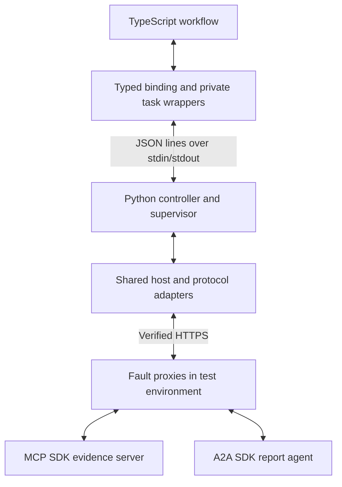

# How the protocol example is wired

The executable example reads evidence from an MCP server, asks an A2A agent to
select facts, polls the task, validates the returned report, and publishes a
result. The application currently runs in TypeScript. The effectful Meda version
that calls this same host is still to be implemented.

## Start with the application

Read [client/workflow.ts](../experiments/interop_d0/client/workflow.ts), especially
`runWorkflow`. Its initial calls are actual executable source:

```typescript
const evidence = await host.readEvidence(input.documentId);
if (evidence.kind === "Error") return errorResult(evidence);
let selectedIds = input.includeIds;
let task: TaskResult = await host.submit(evidence.value,
  input.requestClarification ? undefined : selectedIds);
```

The remainder of the function handles task states. Working tasks call
`host.observe(task.ref)`. Required input can call `host.provideInput` on the same
reference. Completion passes the artifact through `validateReport` before
returning Success. Errors and uncertain delivery have explicit branches.

The application's API consists of five operations:

```typescript
interface HostApi {
  readEvidence(documentId: string): Promise<EvidenceResult>;
  submit(evidence: Evidence, includeIds?: readonly string[]): Promise<TaskResult>;
  observe(ref: TaskRef): Promise<TaskResult>;
  provideInput(ref: TaskRef, includeIds: readonly string[]): Promise<TaskResult>;
  cancel(ref: TaskRef): Promise<TaskResult>;
}
```

These signatures come from [bindings.ts](../experiments/interop_d0/client/bindings.ts).
The application uses an opaque task wrapper; its binding privately holds the
host's reference token.

## Runtime connections



The controller and host are in one Python process. The TypeScript application
runs in a Node child process; each SDK peer runs in a separate process. The
controller launches and supervises them. The diagram shows the data path;
[runner.environment](../experiments/interop_d0/runner.py) owns fixture startup.

The fault proxies let tests change or drop actual SDK responses. They are test
infrastructure, not a required application API. The peers implement deterministic
fixture behavior: this example makes real protocol requests but does not invoke
an LLM or a production service.

## Follow one call through the code

1. [workflow.ts](../experiments/interop_d0/client/workflow.ts) calls
   `host.readEvidence("evidence-42")`.
2. [bindings.ts](../experiments/interop_d0/client/bindings.ts) validates/decodes
   values and delegates the operation to an exchange function.
3. [main.ts](../experiments/interop_d0/client/main.ts) supplies that exchange:
   write a call frame to stdout and await the matching controller response.
4. [runner.run_client](../experiments/interop_d0/runner.py) receives the frame and
   invokes `Host.call(operation, arguments)`.
5. [host.py](../experiments/interop_d0/host.py) checks authority, limits and the
   pinned binding, then sends protocol requests using
   [transport.py](../experiments/interop_d0/transport.py).
6. [sdk_peers.py](../experiments/interop_d0/sdk_peers.py) receives the request
   through the official MCP or A2A SDK. Results return through the same layers.

| Application call | Wire operation in this profile |
| --- | --- |
| `readEvidence` | MCP discovery/checks, then `tools/call` for `evidence.read` |
| `submit` | Agent Card discovery/checks, then A2A `SendMessage` with evidence and selected IDs |
| `observe` | A2A `GetTask` |
| `provideInput` | A2A `SendMessage` with the existing task/context and supplied IDs |
| `cancel` | A2A `CancelTask` |

Discovery checks can accompany later operations too; they consume the shared
budget. Application Success is a proposed result. The controller passes it to
`Host.finish`, which closes the root, performs bounded cleanup, and decides the
final publication. Fatal root outcomes can override proposed success.

## Run one complete example

Install the pinned environment using the
[reproduction instructions](../experiments/interop_d0/README.md). Then run this
from the repository root; it uses the existing runner without creating a new
application or running the full acceptance corpus:

```sh
experiments/interop_d0/.venv/bin/python - <<'PY'
import json
from experiments.interop_d0.runner import compile_client, execute_workflow

compile_client()
receipt = execute_workflow({})
print(json.dumps(receipt["result"], indent=2))
print("Dispatched protocol calls:")
for event in receipt["trace"]:
    if event["event"] == "dispatch":
        print(event["protocol"], event["method"])
PY
```

An empty scenario selects the default successful fixture. Its report selects
`f1 = blue` and `f2 = square` from document `evidence-42`, revision 1. The output
also shows discovery, evidence read, task submission and observation requests.
Scenario dictionaries configure test fixtures; they are not an end-user API.

## Where Meda fits

The [existing Meda policy sample](../experiments/interop_compare/clients/policy.meda)
is executable in the earlier pure comparison. It receives a Snapshot and returns
a Decision such as Read, Submit or Poll. Python orchestration performs that action.

The next Meda arm must execute host calls and continue handling typed results
inside the real Meda evaluator. It should reuse the common host, protocol adapters
and peer fixtures shown above. Those direct-call bindings and effectful evaluator
integration are the missing connection, tracked in
[#10](https://github.com/meda-lang/meda/issues/10). A complete effectful Meda sample
does not exist yet; the [profile](interop-design-amendment.md) describes proposed
semantics rather than an implemented example.
